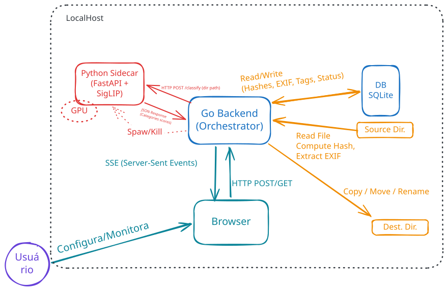

# PhotoOrganizer

O PhotoOrganizer é um utilitário focado em organizar fotos locais com base em metadados e classificação visual utilizando o modelo SigLIP. O projeto é composto por um núcleo escrito em **Go** e um serviço de classificação (sidecar) escrito em **Python**.

## Arquitetura do Sistema



## Estrutura do Projeto

*   **`cmd/organizer/`**: Ponto de entrada da aplicação principal (Go).
*   **`internal/`**: Lógica de domínio e serviços principais em Go (ex: manipulação de arquivos, regras de negócio).
*   **`sidecar/`**: Serviço Python em FastAPI responsável por fazer a inferência visual utilizando modelos de IA.

---

## 🚀 Como Iniciar

O projeto é dividido em duas partes que podem rodar simultaneamente: o organizador em Go e o Sidecar em Python.

### 1. Rodando o Sidecar (Python)

O sidecar fornece uma API local para classificação visual das fotos.

**Passos:**
1. Ative o ambiente virtual (se estiver utilizando o padrão local):
   ```bash
   # No Windows (PowerShell):
   .\.venv\Scripts\Activate.ps1
   # No Linux/macOS:
   source .venv/bin/activate
   ```
2. Inicie o servidor FastAPI:
   ```bash
   python -m sidecar.server
   ```
O sidecar irá baixar/carregar o modelo SigLIP (isso pode demorar um pouco na primeira execução) e iniciar na porta `8000` (por padrão).

### 2. Rodando o Organizador (Go)

Em outro terminal, você pode rodar a aplicação principal responsável por orquestrar a organização dos arquivos:

**Passos:**
1. Baixe as dependências (se necessário):
   ```bash
   go mod tidy
   ```
2. Execute o projeto:
   ```bash
   go run cmd/organizer/main.go
   ```
*(Opcional: Você também pode compilar um binário com `go build -o organizer.exe ./cmd/organizer`)*

---

## 🔌 API do Sidecar

O sidecar foi construído com **FastAPI**. Isso significa que a documentação interativa (Swagger UI) é gerada automaticamente.

Quando o sidecar estiver rodando, acesse o Swagger no seu navegador:
👉 **[http://127.0.0.1:8000/docs](http://127.0.0.1:8000/docs)**

### Rotas Disponíveis

*   `GET /health`
    *   **Descrição**: Retorna o status de integridade do servidor e verifica se o modelo de inteligência artificial já está carregado e em qual dispositivo (CPU/GPU).
    *   **Exemplo de Resposta**: `{"status": "ready", "device": "cpu"}`

*   `POST /classify`
    *   **Descrição**: Recebe o caminho absoluto de uma imagem e retorna os *scores* (avaliações) das tags configuradas na taxonomia.
    *   **Body (JSON)**:
        ```json
        {
          "path": "C:/caminho/absoluto/para/foto.jpg"
        }
        ```
    *   **Comportamento**: Retorna um erro `404` se a foto não existir ou `503` se o modelo ainda estiver em carregamento.

---

## 🛠 Testes (Go)

Para rodar os testes unitários garantindo que as regras de domínio estão funcionando:

```bash
go test ./... -v
```

*(Recomendado utilizar a flag `-race` para detectar condições de corrida: `go test -race ./...`)*
